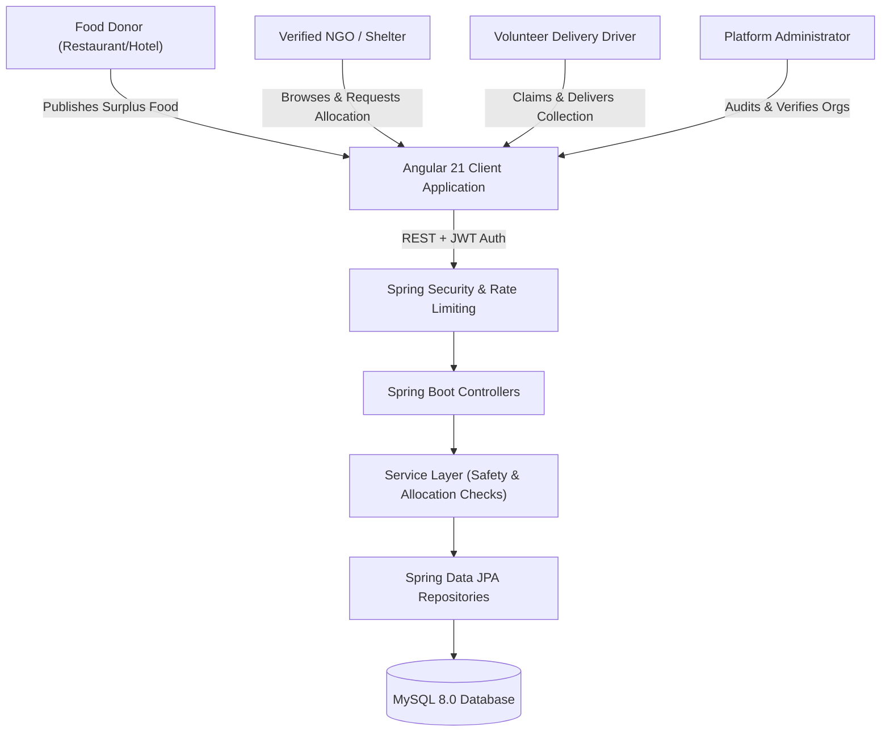

# Food Waste Collection & Redistribution System

An enterprise-grade, full-stack platform connecting food donors (restaurants, caterers, grocery stores, hotels) with verified non-governmental organizations (NGOs) and volunteer delivery networks to eliminate food waste and fight hunger.

---

## 🌟 Architecture Overview

The system consists of a **Spring Boot 4 / Java 21** RESTful API backend, a reactive **Angular 21** standalone-component frontend, and a relational **MySQL 8.0** persistence tier.



---

## 👥 User Roles & Real-World Workflows

| Role | Permissions & Responsibilities | Key Capabilities |
| :--- | :--- | :--- |
| **Donor** | Businesses donating surplus food | • Create food donations with food safety parameters (safe-use deadlines, allergens, storage, pickup location)<br>• Review and approve/reject incoming redistribution requests from verified NGOs<br>• Track live pickup handover status |
| **NGO** | Verified charitable organizations & food banks | • Discover available food donations with real-time remaining quantities<br>• Submit redistribution requests with required quantities and beneficiary counts<br>• Receive in-app notifications on approval/rejection<br>• Coordinate with collection volunteers |
| **Volunteer** | Collection & transport logistics partners | • Browse available pickup tasks across service zones<br>• Claim pickups and track route via Google Maps integration<br>• Advance collection status: `SCHEDULED` ➔ `IN_PROGRESS` ➔ `COLLECTED` ➔ `COMPLETED` / `FAILED`<br>• Log handover timestamps and delivery notes |
| **Admin** | Trust, safety, and system governance | • Review and approve/reject NGO verification applications<br>• Toggle user access and manage user accounts<br>• Review complete immutable administrative audit trail (`AuditLog`)<br>• Export real-time aggregated system impact reports in CSV format |

---

## 🛡️ Food Safety & Integrity Guarantees

1. **Strict Future Deadlines**: The system strictly forbids donating food with past expiry times or past safe-use deadlines.
2. **Allergen & Storage Mandatory Disclosures**: All donations require dietary metadata, allergen notices (e.g. Gluten, Nuts, Dairy), and storage instructions (e.g. Refrigerated below 4°C).
3. **Over-Allocation Prevention**: Under concurrent requests, an NGO cannot reserve more than the donation's available remaining quantity (`quantity - allocatedQuantity`).
4. **NGO Verification Requirement**: Unverified organizations cannot claim or request food donations until administratively audited.
5. **Quantity Restoration**: If an approved request is cancelled, the allocated quantity is automatically restored back to the food donation.

---

## 📊 Live Metrics & Data-Driven Dashboards

All numbers across donor, NGO, volunteer, admin dashboards, and public landing pages are derived exclusively from live database queries (never hardcoded):
- Public impact stats (`GET /api/reports/stats`) return real-time counts: `totalUsers`, `totalDonors`, `totalNgos`, `activeNgos`, `totalDonations`, `totalRequests`, `totalPickups`, `activeVolunteers`.
- Platform admins can download official CSV reports (`GET /api/reports/export/csv`) summarizing all system entities without double-counting.

---

## 🧪 Automated Testing & Verification

Both frontend and backend are covered by comprehensive automated test suites:

- **Backend Unit & Integration Tests**: 15 tests passing (`DonationServiceTest`, `FoodRequestServiceTest`, `PickupServiceTest`).
- **Frontend Vitest Test Suites**: 43 test suites / 43 tests passing with 0 errors and 0 warnings.
- **Production Build**: Angular ahead-of-time (AOT) production bundle passes with zero budget warnings.

---

## 🚀 Quick Start Guide

### Option 1: Docker Compose (Single Command)
```bash
docker compose up --build -d
```
Access the application at `http://localhost:80` (or `http://localhost:4200`) and API at `http://localhost:8080/api`.

### Option 2: Local Development Setup
Refer to [SETUP.md](file:///c:/Users/swatip/OneDrive/Desktop/webvibes%20syllubus/Filed%20Projects/Food-Waste-Collection-Redistribution-System/SETUP.md) for full step-by-step installation, test execution, and local run instructions.
